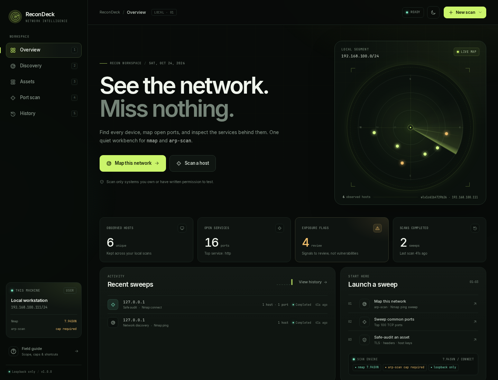
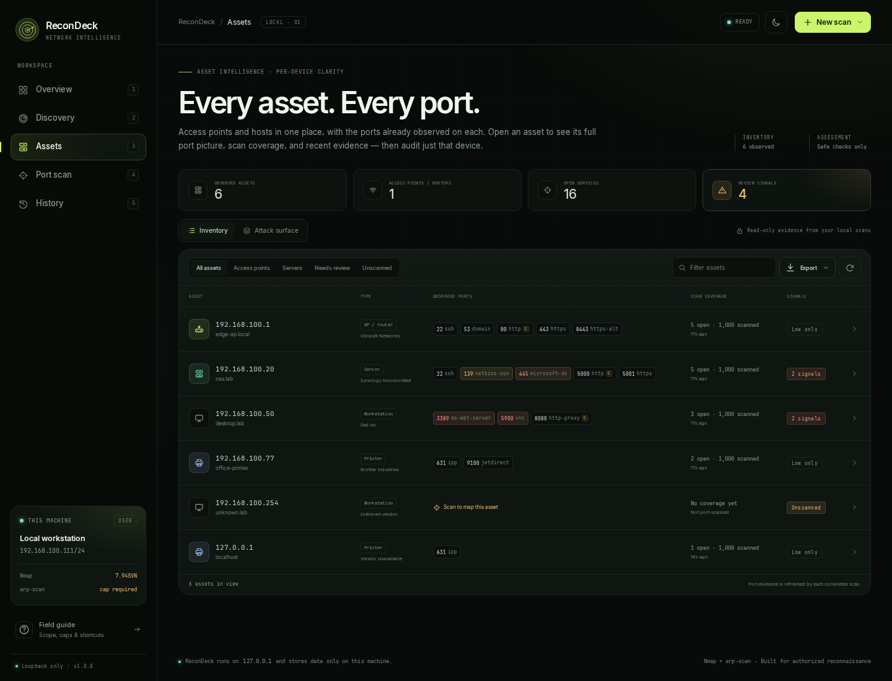
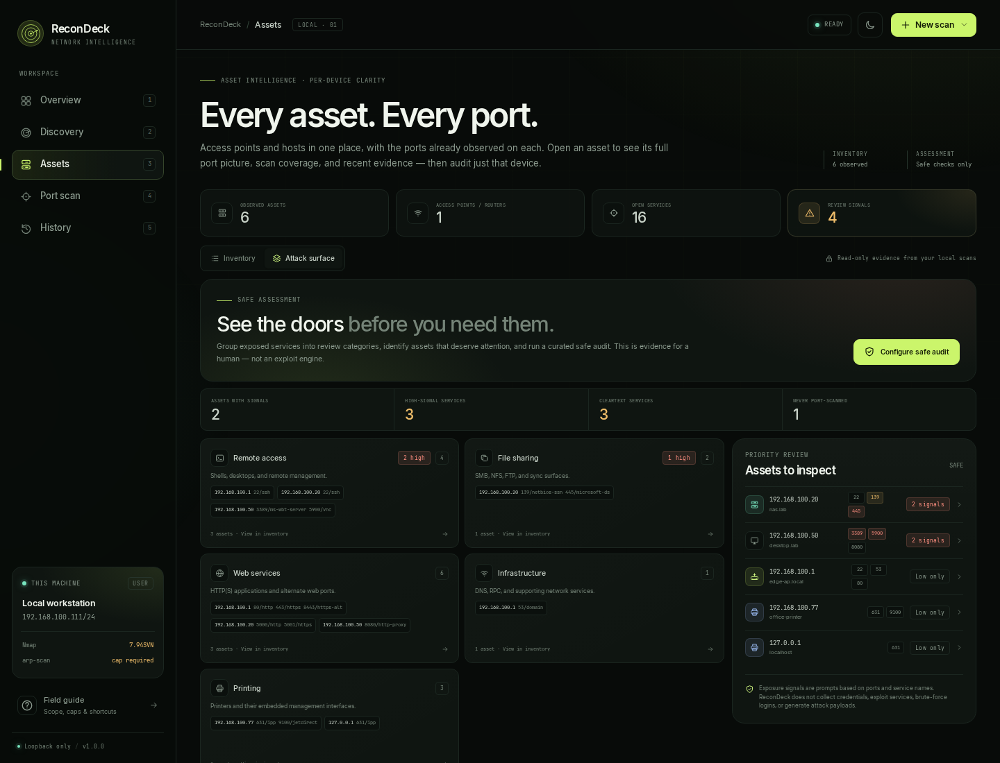
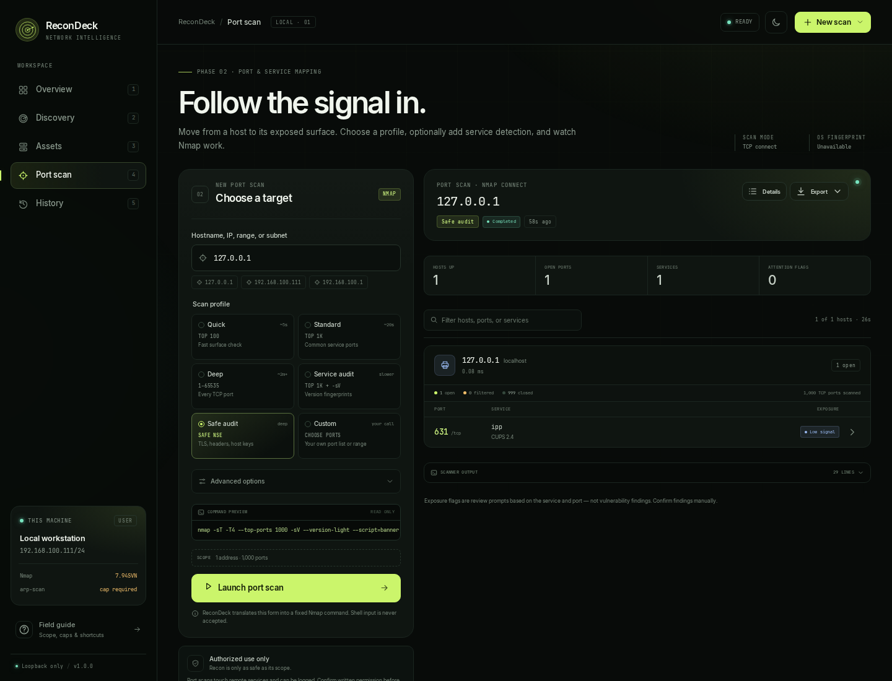

# ReconDeck

**A local-first graphical workbench for `nmap`, `arp-scan`, and TCP port scanning.**

ReconDeck turns a familiar terminal workflow into a visual reconnaissance desk:
map the local network, inspect each access point or asset, launch scoped port
scans, review a safe attack-surface assessment, watch Nmap work in real time,
and keep a searchable local scan history. It runs only on your machine, binds to
`127.0.0.1`, and has no telemetry, cloud service, or third-party front-end
dependencies.



_Screenshots use illustrative demo data. ReconDeck itself only displays evidence
from scans on your machine._

## Start it

```bash
cd recondeck
./stop.sh   # optional if an older build is still running
./start.sh
```

The launcher starts the local server, opens a dedicated browser app window when
Brave or Chromium is available, and leaves the server running in the background
so you can close the window and return later. If it detects an older ReconDeck
build on the same port, it stops it and starts the current version.

| Command | What it does |
| --- | --- |
| `./start.sh` | Start ReconDeck and open the app window; replaces an older running build. |
| `./stop.sh` | Stop the background ReconDeck server. |
| `./install-desktop.sh` | Add ReconDeck to your application menu. |
| `RECONDECK_FOREGROUND=1 ./start.sh` | Run in the foreground and stop with `Ctrl+C`. |
| `RECONDECK_PORT=8778 ./start.sh` | Use a different local port. |
| `RECONDECK_NO_BROWSER=1 ./start.sh` | Start without opening a browser. |
| `RECONDECK_APP_WINDOW=0 ./start.sh` | Use a normal browser window instead of app mode. |
| `RECONDECK_DATA_DIR=/path ./start.sh` | Store the scan database somewhere else. |
| `python3 app.py --open` | Run directly from Python, opening a browser. |

The default URL is **http://127.0.0.1:8777**.

### Requirements

- Linux with Python **3.10+** and Flask 3
- `nmap` on `PATH`
- `arp-scan` on `PATH` for raw local-device discovery (optional)
- A modern browser

Install the Python dependency if needed:

```bash
python3 -m pip install -r requirements.txt
```

## What is inside

### Overview

A live local-segment map, observed-host and open-service counts, review signals,
seven-day activity, recent sweeps, and one-click entry points into the two main
workflows.

### Discovery

ARP sweep via `arp-scan` when raw packet access is available, or Nmap ping
discovery when it is not.

- Auto engine selection.
- Interface selection for multi-homed machines.
- Device inventory with IP, hostname, MAC, vendor, open-port count, and last-seen
  time.
- MAC/vendor data when ARP is available; a clear user-mode fallback otherwise.
- Clickable device details with an immediate jump into a per-asset port scan.

### Assets

A per-device workspace that keeps each access point, router, server, printer, and
workstation visible as its own record.



- AP/router, server, printer, and workstation classification, using the local
  gateway, vendor, hostname, and observed service clues.
- Observed-port chips directly in the inventory row, colour-coded by exposure
  prompt.
- Per-asset scan coverage: open, filtered, and closed counts from the latest TCP
  scan.
- Asset filters for access points, servers, needs-review, and never-scanned
  devices, plus free-text search.
- A full asset drawer with port picture, coverage bar, evidence history, and a
  focused scan control.
- Direct **Scan this AP / asset** action with Quick, Standard, Service audit, or
  Safe audit profiles.
- Inventory export as CSV or JSON.

The inventory reflects the most recent completed port scan for each asset. Older
observations remain available in scan history.

### Attack surface

The **Assets → Attack surface** tab groups observed services into review
categories: remote access, file sharing, management planes, data stores, web
services, infrastructure, mail, printing, and other. It identifies high-signal
and cleartext services, counts never-scanned assets, ranks assets for review,
and links each category back to a filtered inventory.



This is a **safe assessment layer**, not an exploit engine. It does not contain
exploit execution, credential attacks, brute-force login attempts, denial of
service, payload generation, or post-exploitation tooling. Exposure signals are
prompts for a human to verify, not vulnerability findings.

### Port scan

A form-driven wrapper around a fixed set of Nmap arguments. It never accepts
arbitrary Nmap flags or shell input.



| Profile | Coverage | Built-in limits |
| --- | --- | --- |
| Quick sweep | Top 100 TCP ports | Up to 256 addresses |
| Standard sweep | Top 1,000 TCP ports | Up to 128 addresses |
| Deep sweep | All 65,535 TCP ports | Up to 8 addresses |
| Service audit | Top 1,000 + version detection | Up to 64 addresses |
| Safe audit | Top 1,000 + versions + curated safe NSE checks | Up to 16 addresses |
| Custom ports | Your port list or range | Up to 128 addresses |

Optional controls include service/version detection, Nmap default NSE scripts,
OS fingerprinting when raw access is available, `-Pn` host-presumption, and Nmap
timing templates T3–T5. ReconDeck uses a TCP SYN scan when Nmap has raw packet
access and a TCP connect scan otherwise.

**Safe audit** runs a fixed, curated NSE allow-list for banners, HTTP titles and
headers, HTTP methods, TLS certificates and ciphers, SSH host keys and algorithms,
and SMB identity. It is designed to stay non-intrusive, though it still generates
scan traffic. No user-supplied script names are accepted.

Results include hosts, open services, product/version banners, CPEs, scripts,
OS guesses, per-host open/closed/filtered coverage, and conservative
exposure-review notes. A filter narrows results by host, port, or service.

### History

Every sweep is saved to a local SQLite database. Open any scan to see its result
summary, hosts, ports, command, and raw output. From there you can:

- inspect the latest per-host port evidence and asset scan history;
- export JSON, CSV, or the raw log;
- reload a scan's settings into the form;
- delete the scan and automatically rebuild the observed-host inventory.

Existing databases from the earlier four-page build are migrated in place when
the current server starts. Open ports are retained and lightly backfilled so
they still appear in Assets; a fresh per-asset scan fills in full open/closed/
filtered coverage.

## Raw access: ARP, SYN, and OS detection

Without raw packet access, ReconDeck deliberately remains in **user mode**:
Nmap ping discovery and TCP connect scans still work, but ARP discovery, Nmap
SYN scans, and OS fingerprinting do not. The UI reports this state clearly.

You can grant narrow file capabilities instead of running the web server as
root:

```bash
sudo setcap cap_net_raw,cap_net_admin,cap_net_bind_service+eip "$(command -v nmap)"
sudo setcap cap_net_raw+eip "$(command -v arp-scan)"
```

Then restart ReconDeck. Capabilities are often cleared when a package is
upgraded, so they may need to be re-applied.

**Running the whole GUI as root is not recommended.** Prefer file capabilities,
and only enable them on a machine where you understand the implications. Some
containers block `AF_PACKET` or set `no_new_privs`; in that environment even
`setcap` may not be enough. Auto mode handles this by falling back to Nmap ping
discovery.

## Scope and safety by design

- Only scan systems you own or have explicit, documented permission to test.
  The UI repeats this warning, but it cannot grant authorization.
- The server binds only to `127.0.0.1`, validates the Host header, rejects
  non-loopback clients, and requires a per-process API token on every API call.
- Scan requests must be JSON. Targets, interfaces, profiles, timing options, and
  ports are validated against strict allow-lists.
- Scanner commands are fixed argument arrays and are executed without a shell.
- No arbitrary Nmap flags, script names, output paths, or interfaces can be
  injected through the form.
- The safe-audit profile uses a hard-coded NSE allow-list. Exploitation,
  brute-force, credential collection, denial-of-service, and post-exploitation
  capabilities are intentionally excluded.
- One scan can run at a time. Every job has a safety timeout and can be stopped.
- Host-count caps scale with how expensive a profile is.
- HTML is escaped, CSV output is protected against spreadsheet formula
  injection, and the browser receives a restrictive Content Security Policy.
- Scan data lives in `data/recondeck.db` and exports are generated locally.
- Inventory evidence is read-only. A per-asset scan targets only the selected
  asset.

NSE default scripts can be active against the target, so they are off by
default. Safe-audit scripts are curated and profile-locked. Exposure notes are
review prompts based on ports and service names; they are **not vulnerability
findings**.

## Keyboard

| Keys | Action |
| --- | --- |
| `G` then `1` / `2` / `3` / `4` / `5` | Go to Overview / Discovery / Assets / Port scan / History |
| `/` | Focus the active page's search field |
| `Esc` | Close the active dialog, drawer, or menu |

## Development and tests

```bash
cd recondeck
python3 -m unittest discover -s tests -v
```

The test suite currently covers target and port validation, command construction,
safe-audit allow-lists, refusal of privileged options in user mode, Nmap XML /
arp-scan parsing, port coverage, service categories, inventory merging, latest
scan semantics, asset history, inventory export, scan deletion, local API token
enforcement, Host-header rejection, and JSON-only scan requests. Run it with the
command above; all tests are local and do not scan remote networks.

To run an isolated data directory:

```bash
python3 app.py --port 8778 --data-dir ./data-dev
```

Server output goes to `data/recondeck.log` when started with `./start.sh`.

## Project layout

```text
recondeck/
├── app.py                 Python entry point and launcher
├── recondeck/
│   ├── __init__.py        Flask application factory and API
│   ├── scanner.py         Validation, scanner commands, parsing, jobs
│   ├── risk.py            Exposure notes, categories, cleartext cues
│   └── store.py           SQLite scans, assets, and port coverage
├── templates/index.html   Application shell
├── static/                Local CSS, JS, fonts, and icon
├── tests/                 Fast unit and API tests
├── start.sh               Background launcher / app-window opener
├── stop.sh                Server shutdown
└── install-desktop.sh     Optional application-menu installer
```

ReconDeck was built for authorized reconnaissance. Keep it that way.
